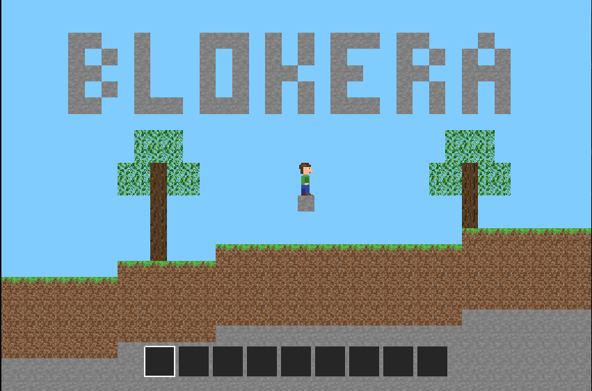
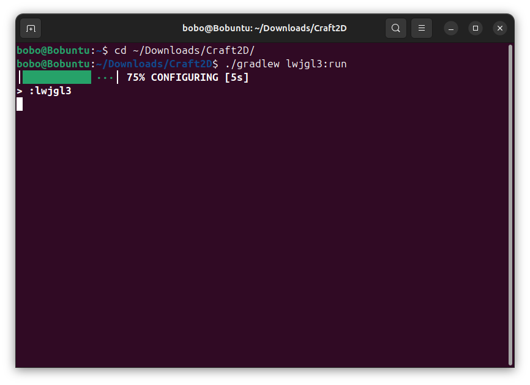

# 2D-Craft

A 2Dsandbox game insoired by Minecraft coded in java, using LibGDX. You can explore an rendomly genereted world, mine and place Blocks, open the Inventory and craft in a 2*2 
craftingslot in the inventory.



*Don't wonder, Blockera will be the new name of the game.*


## What is 2D-Craft?

Craft2D is a open world game with randomly gereratd world. Here’s what’s working in the game so far:

- **Random world Generation:** random World generation with terrain, stone-, dirt-, grass-layers, and trees.
- **Block Mining & Placement:** You can Breack blocks(no cooldown yot and break animation) and place Blocks.
- **Inventory & Hotbar:** A 9 slot hotbar with a 9*3 inventory and a 2*2 crafting area.
- **Custom Visuals:** All textures are hand 16*16 textures pixeld in LibreSprite

---

## How I Built It

After short Project, I wanted to do a longer in Java and I thaught, Minecraft in 2D is perfect for that. I learned, how java and LibGDX works. I'm stil a beginner in coding java,
like you see in my code (I'm sure you can do things much shorter, like the crafting recepies), but over all, I like coding on java, and I will go on.

## What I Want to Add
- Block breaking time and animation
- 3*3 craftingtable with more crafting recipes
- Improving random world generation (adding big mountains with snow and maybe structures)
- Adding caves
- Adding biomes
- Adding more blocks (sand, cobblestone, ores...)


### Eurekas
* **Crafting:** When you wanted to craft planks, you were able to craft 4 planks with 2 wood and get only 4 planks(place the planks next to each other), But I found very fast a sulution: add a variable, that goes up, when you place things in the craftingtable, and only craft, when the right amount of blocks
is in the craftingtable.
* **Variables:**My settings for the game are in a certain class, and, when I wanted to change something(like world width), I had to look up in a class with 300 lines code. Also when I need a variable in another class, I had to look long, where its definied, to use it in another class. Fot that I created a cerrtain class, where all variables, that i need in more classes and are for teh game settings, are saved in their own class.


### Rabbit-Holes

* **Pick and set up the graphic library:** The first thing i've done, was setting the graphic library, and as an java beginner, I first didn't know, what that is, and it took very long, to pick the correct one and set it up to work.
* **Physics & Colision:** (Fruher)I had a lot of bugs with the colision, like you could walt in ther blocks, or you you flighed in the air.
With a lot of time I fixed it, with adding more If clauses. And even now is a bug, that when you jump, you can still bug trough blocks,
but I'm mot sure, how you can do that and haven't fixed the bug yet.


## Controls
- **A** to go left
- **D** to go right
- **Space** to jump
- **Shift** to sneak
- **E** to open inventory
- **Left click** in world: breaks block, in inventory: takes/puts down whole stack
- **Right click** in world: places block, in inventory: takes/puts down one block


---

## How to Run
**Option 1:**
- **in the browser** on itch.io: https://kkttppr.itch.io/craft2d

**Option 2(on Linux):**

### Prerequisites
- **Java Development Kit (JDK):** Version 17 or higher
- **Git**

### Steps
1. **Download the repository:**
    (in terminal)
    ```bash
    git clone https://github.com/ez-cyver/Craft2d.git
    ```
    (in web)
    download .zip file
2.  **then unzip it:**
    (in terminal): 
    ```bash
    unzip Craft2D.zip -d Craft2D
    ```
    (in Files): search for the file (mostly in Downloads/Craft2D), right-click it and unzip.
3.  **go to file:**
    (in terminal)
    ```bash
    cd ~/Downloads/Craft2D (or where you saved the game)
    ```
4.  **start game:**
    ```bash
    ./gradlew lwjgl3:run
    ```

